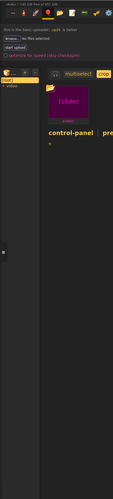
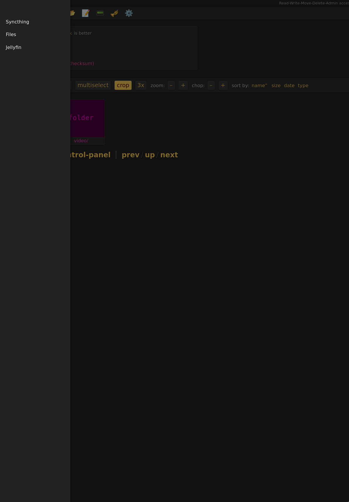

# Minimal, self-hosted services

THIS REPOSITORY IS A PUBLIC MIRROR. PULL REQUESTS ARE CURRENTLY DISABLED, OPEN AN ISSUE IF YOU WANT TO CONTRIBUTE.

This is an experiment for a minimal self hosted stack, that is trying to serve what one person needs out of a cloud environment.
Nowhere near complete, right now it works as a media center. It should be light enough to run on a raspberry pi, or a small VPS.
My personal setup is a pi4, with an external hard drive.

Included:
- Jellyfin: watching videos is just better with it.
- Copyparty: A very well-made and light file server/browser. The gui could use some work, but it is fast and more featureful than everything else I could find.
- Syncthing: One of the best tools for the average person to send and receive files from friends and family.

## Tailscale

Tailscale was selected as the "connectivity" solution, because it is very easy to set up, and use. It is also free for personal use.
This is the biggest issue with self-hosting, having a secure way to access your services. Most solutions are cumbersome to set up, with a lot of configurations and knowledge required.
Tailscale reduces it to one value.

Treat the tailnet as a trusted area, and don't share it with people you don't fully trust.
Use syncthing to share files with anyone outside your household, that is fast, easy-ish and secure.
NEVER expose it to the public internet as it is provided, because it won't be secure. I will NOT be responsible for any data leak, loss, or compromise if you do so.

## Configuration

You need to create a file named `.env` in the root of the project. You can rename/copy the `env` file and use it as a base.

To start, you need a tailscale auth key, and set it in the env file as `LOCALHOST_TS_AUTH_KEY`.
Instructions are here.
https://tailscale.com/docs/features/access-control/auth-keys

You also need tailscale installed on any machine you want to access the services from, and logged in with your account.
So your pc, your phone, your tablet, etc.

Then you have to set the `ADMIN_USER` variable to what you see in your tailscale account as your username.
You can share the machine with others, and they won't have admin privileges.
Everything is configured to treat them as regular users.

Authorization uses tailscale's identity headers, so you can just visit the pages from your tailnet, and you will be logged in automatically.

This is the main and only security feature of this stack.
If you don't know what you're doing, then don't change any of these settings.

I could not lower the barrier of entry any further for now.

## Running

Once you have those two set up, run docker compose up -d, and you can access everything on your tailnet.

## Navigation:

Every page has a dynamic sidebar added to them, that contains the links to every application.

You can use this to navigate.

For jellyfin, if you logged out manually, you can log back in by visiting the page again from the sidebar.

# Future plans

Syncthing covers *private* file sharing needs, but I want a public solution as well that could be used for community building.
Either use the ol' reliable torrent, or [ipfs](https://ipfs.tech/). 
The only thing I'm willing to host is a public index so files can be found. Anything else is too expensive to be viable.

I also want a chat solution that can be used for personal messaging. 
Something you can use to send messages to friends and family, people you trust.
NOT a social media solution. Only a private application that works peer to peer, with at most a handful of users in the same channel.

I'm either eying jami web (needs testing), or I have an internal experiment that sends them over syncthing as files. 
The latter is appealing, because the tools are already here and I don't need to set up any additional channels between each node. 

I also want alternative connectivity solutions, tailscale can not be the only option.
Syncthing was also selected to open up this possibility, restrict tailscale down to "have a reachable address for every service". 